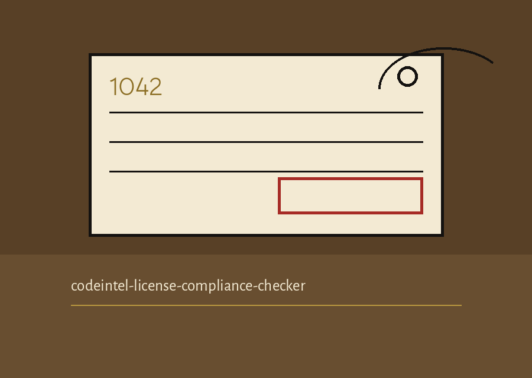

# codeintel-License-Compliance-Checker

Title block: the name above is set in Bellota Text in theatre black on programme cream, ruled as a day book entry, with a date line above and an entry line below. No image beside the headings is directed in the theme entry, and none is invented here. That gap is recorded in the iterations file as part of the entry formal incompleteness.

Scans a project's dependencies and lists their licenses, highlighting potential compliance issues. An entry is flagged in the report when its license is UNKNOWN (pip reported no license) or when its license string contains a copyleft family name: GPL, LGPL, AGPL, MPL, EPL, or CDDL. The report ends with a summary count of flagged entries. Flagging marks an entry for a human compliance look, it is not a judgement that the license cannot be used. - Focused on Tools for static code analysis, vulnerability scanning, and code quality assurance

## Install
`git clone https://github.com/ShadowStrikeHQ/codeintel-license-compliance-checker`

> **Marginal note in the day book: wrong organisation.** The install line above names ShadowStrikeHQ. The repository lives under ShadowGuard-AI, and the corrected address is https://github.com/ShadowGuard-AI/codeintel-license-compliance-checker. The line is preserved as printed and flagged here. The README gives no next step after the clone, and none is added here.

## Usage
`./codeintel-license-compliance-checker [params]`

> **Marginal note in the day book: unusable as printed.** The usage line above omits the required project path and cannot be run as shown. The true line is python3 main.py PROJECT_PATH [--output_format text|json] [--log_level LEVEL]. Buttons in the kit read List the Licences, Set the Report Form, Set the Log Level, and Show Help. Headings read Entered in the Book, Names from the Requirements File, No File, Then the Environment, One Package at a Time, Flagged Means Look, and The Count at the Foot.

## Parameters
- `-h`: Show help message and exit
- `--output_format`: No description provided
- `--log_level`: Set the logging level.

> **Marginal note in the day book: No Requirements File Means a Report About This Machine.** A requirements.txt in the project directory wins and its lines are read first. With no such file, a warning is printed and the current environment is reported instead, from pip freeze. That report describes the environment, not the project. A freeze that fails ends the run with exit 1. The parameter list above omits the required positional project path altogether, gives --output_format no description although the parser confines it to text or json with text as default, and gives --log_level no permitted values or INFO default. A project path that is not a directory is refused with exit 1.

> **Marginal note in the day book: A Mention Is Flagged Like a Grant.** Matching is by substring. A licence text that merely mentions one of the family names while saying it does not apply is flagged all the same, and a human sorts the mention from the grant. Each licence is found by one pip show per package, in order, run as this interpreter own pip module. The licence line is taken first, failing that the License-Expression line, failing both the entry stands as UNKNOWN. In json form each entry carries a compliance_flag field and a final count entry is added under its own key. The report is printed even where packages are flagged and the run then exits normally, because a flag never becomes an exit code.

## License
Copyright (c) ShadowStrikeHQ

> **Marginal note in the day book: closing line counted.** The closing line above is the second appearance of the wrong organisation name in the same short file. No licence is named in the README and no terms are given. The absence is recorded and not filled.
