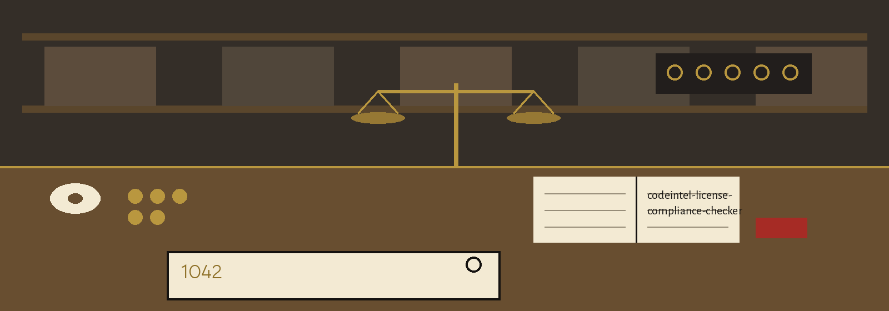

# codeintel-License-Compliance-Checker
Scans a project's dependencies and lists their licenses, highlighting potential compliance issues. An entry is flagged in the report when its license is UNKNOWN (pip reported no license) or when its license string contains a copyleft family name: GPL, LGPL, AGPL, MPL, EPL, or CDDL. The report ends with a summary count of flagged entries. Flagging marks an entry for a human compliance look, it is not a judgement that the license cannot be used. - Focused on Tools for static code analysis, vulnerability scanning, and code quality assurance

## Install
`git clone https://github.com/ShadowStrikeHQ/codeintel-license-compliance-checker`

## Usage
`./codeintel-license-compliance-checker [params]`

## Parameters
- `-h`: Show help message and exit
- `--output_format`: No description provided
- `--log_level`: Set the logging level.

## License
Copyright (c) ShadowStrikeHQ
